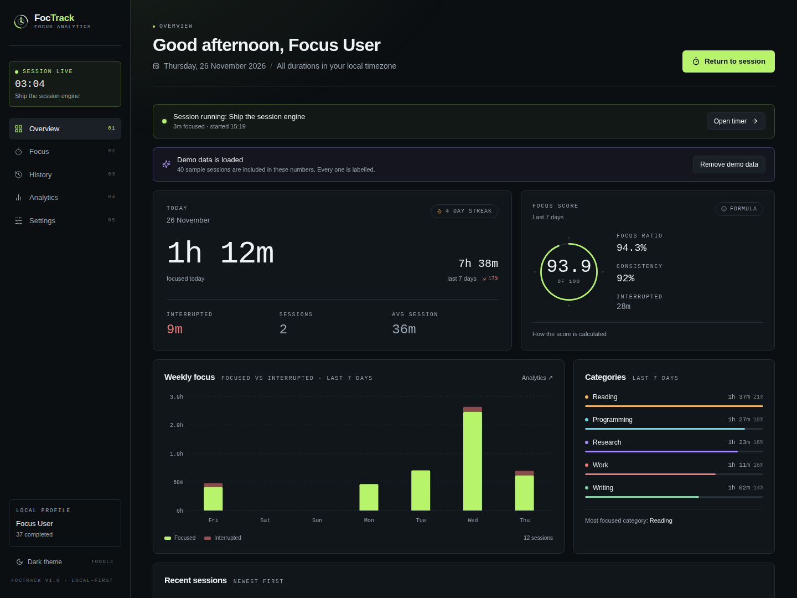
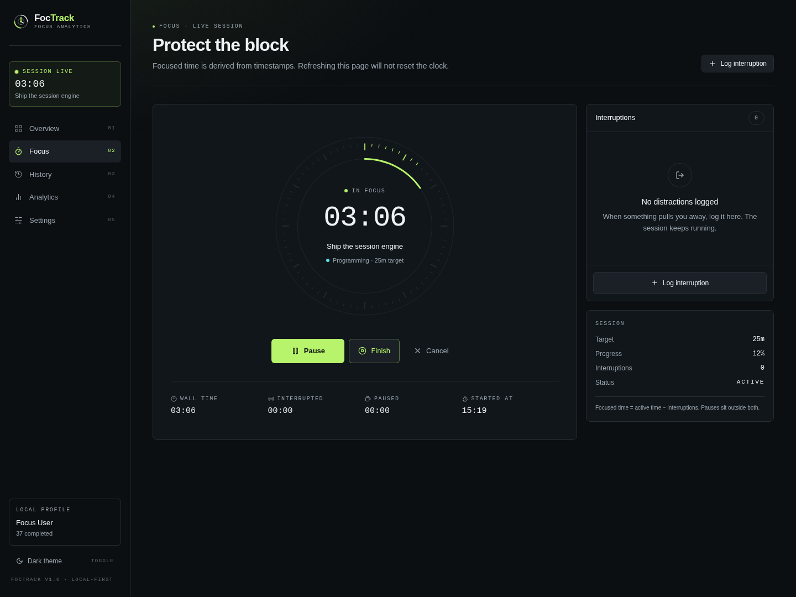
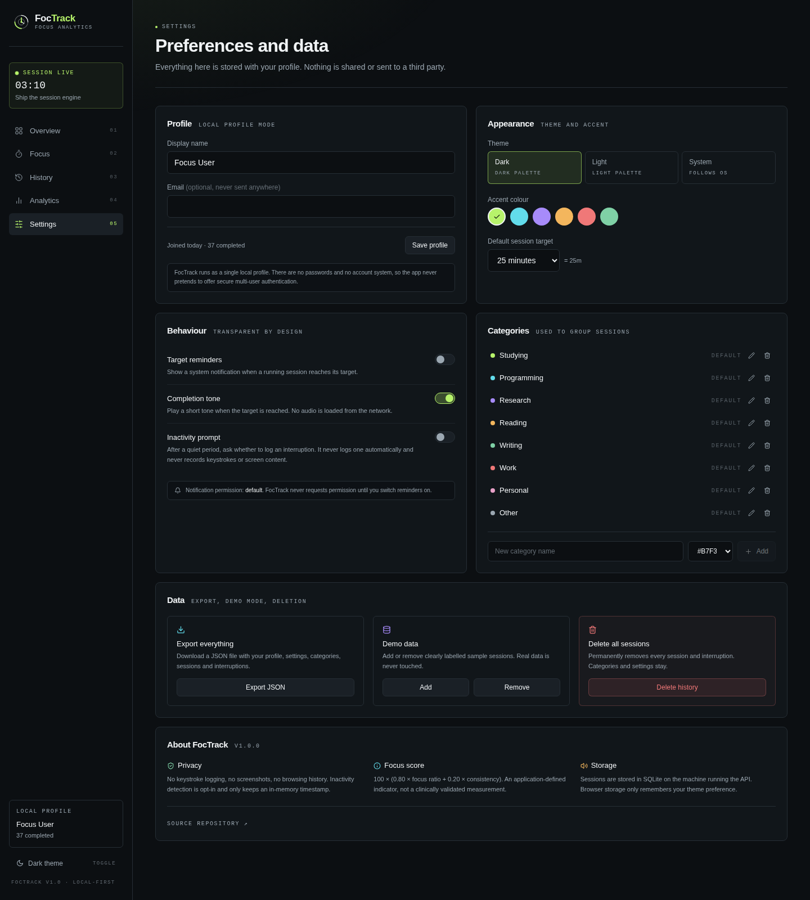
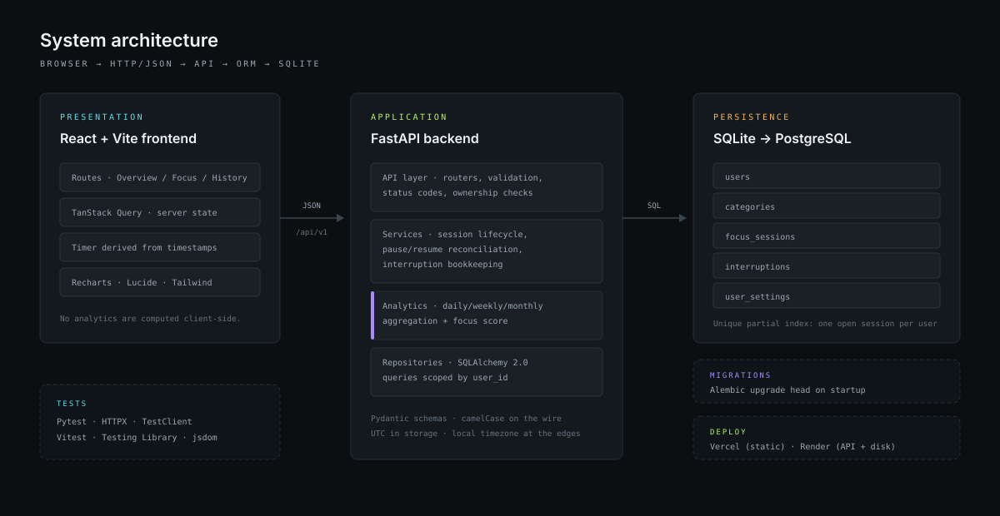
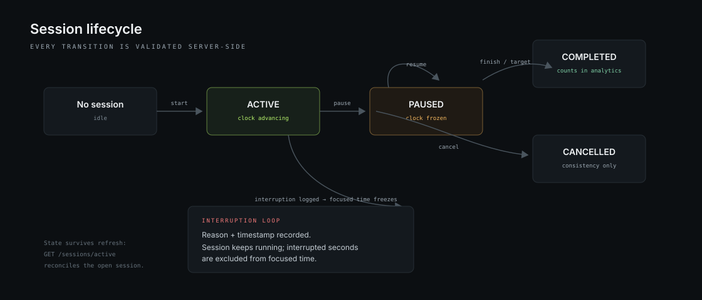
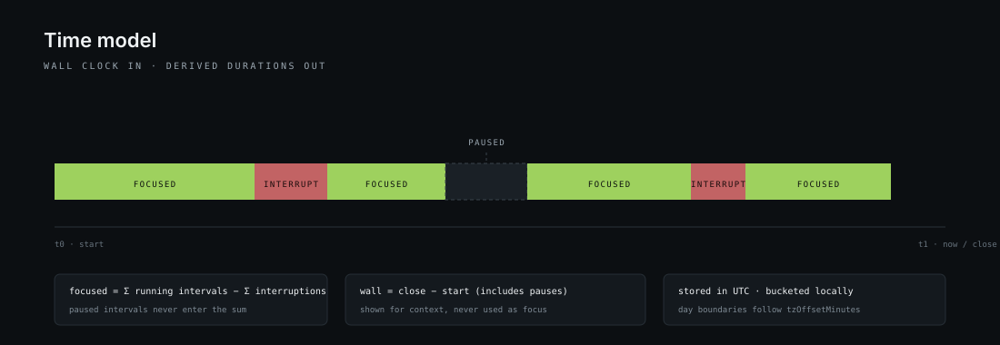
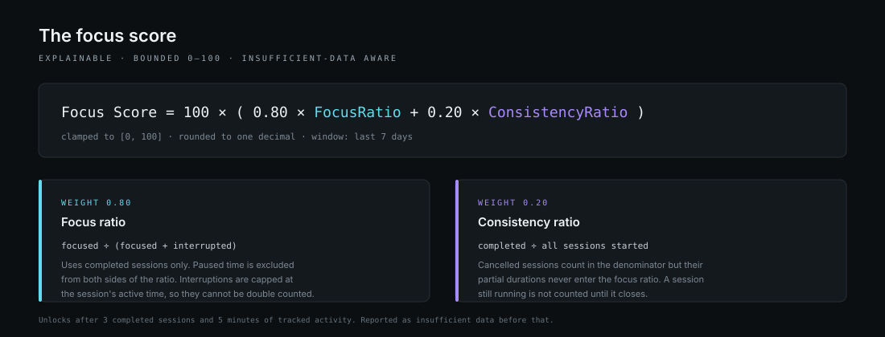

<p align="center">
  
</p>

<h1 align="center">FocTrack</h1>

<p align="center">
  <strong>Measure your focus. Master your time.</strong><br />
  A focus analytics application that separates <em>time spent</em> from <em>time focused</em>.
</p>

<p align="center">
  <a href="#quick-start">Quick start</a> ·
  <a href="#features">Features</a> ·
  <a href="#screenshots">Screenshots</a> ·
  <a href="#architecture">Architecture</a> ·
  <a href="#focus-score">Focus score</a> ·
  <a href="#api">API</a> ·
  <a href="#testing">Testing</a>
</p>

<p align="center">
  <a href="https://github.com/officialarghya29/FocTrack">github.com/officialarghya29/FocTrack</a>
</p>

---

## The problem

Most focus timers record elapsed time rather than attention. A 50 minute session
containing twelve minutes of phone checks is still stored as 50 minutes, so the
metric overstates real focus and offers no basis for improvement.

FocTrack separates focused time, interrupted time and paused time into distinct
quantities. Each distraction is stored with a reason and a timestamp, producing
a dataset that answers specific questions: which categories consume the most
focused hours, when attention breaks, and whether sessions are completed.

Scope is intentionally narrow: one local profile, no social features, no
subscription layer, no team management. FocTrack is a measurement tool, not a
habit game.

## Philosophy

| Principle | What it means in the product |
|---|---|
| Measure, do not assume | Durations come from UTC timestamps, never from a ticking counter |
| Separate focus from presence | Pauses and interruptions are tracked as distinct intervals |
| Be honest about uncertainty | Empty states instead of fabricated statistics; insufficient-data instead of a fabricated score |
| Local-first | Data lives in the user's own SQLite database; export and deletion are first-class actions |
| Explain every number | The focus score has visible weights and a documented formula |
| Visual restraint | One accent colour, minimal motion, no decorative dashboards |

---

## Features

<table>
<tr>
<td width="50%" valign="top">

**Focus timer**
- Timestamp-based clock — refresh, sleep or restart safe
- Start, pause, resume, finish, cancel
- Optional target duration with a progress ring
- One open session per user, enforced in the database
- Session recovery via `GET /sessions/active`
- Session summary after finishing

**Interruptions**
- Seven predefined reasons plus a custom label
- Notes per interruption
- Running and closed interruption display
- Deleting an interruption recalculates focus
- Optional inactivity prompt — never auto-logs

</td>
<td width="50%" valign="top">

**Dashboard**
- Today's focused and interrupted time
- Session count and average session
- Explainable focus score with component breakdown
- Seven-day trend, streak, week-over-week change
- Category breakdown and recent sessions

**History and analytics**
- Search, category, status and date filters
- Sort by duration, paginated
- Session detail with full timeline
- Daily, weekly and monthly charts
- Category, duration and time-of-day distributions
- Interruption reasons and frequency

</td>
</tr>
</table>

**Settings** include profile, dark/light/system theme, six accent colours, default
target, target reminders (with real browser permission), completion tone,
opt-in inactivity prompting, category management, JSON export, demo data mode
and full history deletion.

<p align="center">
  
</p>

---

## Screenshots

Screenshots are captured from the running application. The dataset shown is the
built-in **demo mode** (40 sample sessions), which is labelled in the interface.

### Overview



### Focus timer



### Session history


### Analytics


### Settings



---

## Architecture

<p align="center">
  
</p>

The React client renders state and formats values; it never computes analytics.
FastAPI owns the session lifecycle, validates every transition and aggregates
the numbers. SQLAlchemy talks to SQLite through a database that is designed to
move to PostgreSQL without touching application code.

Full detail: [`docs/architecture.md`](docs/architecture.md).

### Session lifecycle

<p align="center">
  
</p>

---

## Technology stack

| Layer | Technology | Notes |
|---|---|---|
| Frontend | React 18 + Vite 5 + TypeScript | Strict TS, route-level pages |
| Styling | Tailwind CSS 3 + CSS variables | Dark and light themes, user-selectable accent |
| Charts | Recharts 2 | Responsive, labelled, with empty states |
| Icons | Lucide React | Consistent 1.5px stroke set |
| Server state | TanStack Query 5 | Caching, invalidation, optimistic sync |
| Routing | React Router 6 | Five routes + 404 |
| Backend | Python 3.12 + FastAPI | OpenAPI at `/docs` |
| Validation | Pydantic 2 | camelCase on the wire, snake_case in Python |
| ORM | SQLAlchemy 2.0 | Typed mappings, explicit relationships |
| Migrations | Alembic | Applied to `head` at startup |
| Database | SQLite | File-backed, persistent disk in deployment |
| Backend tests | Pytest + HTTPX TestClient | 46 tests |
| Frontend tests | Vitest + Testing Library | 11 tests |
| Deployment | Vercel (frontend) + Render (API) | Config included, not deployed |

---

## Database schema

<p align="center">
  
</p>

| Table | Key columns | Purpose |
|---|---|---|
| `users` | `id`, `username`, `email`, `created_at` | Local profile (one per database) |
| `categories` | `id`, `user_id`, `name`, `color`, `is_default` | Unique per user (case-insensitive) |
| `focus_sessions` | `started_at`, `ended_at`, `status`, `target_duration`, `accumulated_active_seconds`, `paused_seconds`, `last_resumed_at`, `paused_at`, `focused_duration`, `interrupted_duration`, `is_demo` | Session record and clock anchors |
| `interruptions` | `session_id`, `reason`, `custom_reason`, `notes`, `started_at`, `ended_at`, `duration` | Distraction intervals |
| `user_settings` | `theme`, `accent_color`, `default_target_duration`, `notifications_enabled`, `sound_enabled`, `auto_idle_detection_enabled`, `idle_threshold_seconds` | Preferences |
| `alembic_version` | `version_num` | Migration state |

Constraints and indexes:

* `UNIQUE (user_id, name)` on categories.
* `UNIQUE INDEX uq_open_session_per_user ON focus_sessions (user_id) WHERE status IN ('ACTIVE','PAUSED')`
  — makes two simultaneous sessions impossible even under concurrency.
* Foreign keys with `CASCADE` for sessions → interruptions and users → data,
  and `SET NULL` for categories → sessions.
* Indexes on `user_id`, `started_at`, `ended_at`, `session_id`.

---

## Focus score

<p align="center">
  
</p>

```
focus ratio       = focused ÷ (focused + interrupted)
consistency ratio = completed ÷ (completed + cancelled)
focus score       = 100 × (0.80 × focus ratio + 0.20 × consistency ratio)
```

* Clamped to **0–100**, one decimal.
* **Paused time is excluded** from both numerator and denominator — a break does
  not lower the score.
* **Cancelled sessions** affect consistency only; their partial durations never
  count as focus.
* **Interruptions are capped** at active time when recorded, so they cannot be
  double counted.
* Below **3 completed sessions** or **5 minutes of activity** the API returns
  `insufficient_data` and the UI explains what unlocks it.
* The score is an application-defined indicator, **not** a clinically validated
  psychological measurement. The interface states this explicitly.

[`docs/calculations.md`](docs/calculations.md) has the full derivation and
worked example.

---

## Time calculation theory

```
wall time        = now − started_at
active time      = Σ running intervals
paused time      = Σ paused intervals
interrupted time = Σ interruption intervals (clipped to active time)
focused time     = max(0, active time − interrupted time)
```

* Timestamps are stored in **UTC**; day bucketing uses the browser's
  `tzOffsetMinutes` so "today" matches the user's calendar.
* A pause closes any open interruption at the pause boundary.
* Starting a new interruption closes the previous open one.
* Completing or cancelling freezes `focused_duration` and
  `interrupted_duration`; those frozen values feed analytics.
* No client counter is authoritative. The display extrapolates from the last
  server response and re-syncs on every fetch and window focus.

---

## API

Base path: `/api/v1`. Interactive documentation: `http://localhost:8000/docs`.
All responses are camelCase JSON; all timestamps are ISO-8601 UTC.

| Method | Endpoint | Description |
|---|---|---|
| `GET` | `/health` | Service and database status |
| `GET` | `/profile` · `PATCH /profile` | Local profile |
| `GET` | `/sessions/active` | Open session for recovery (or `null`) |
| `POST` | `/sessions` | Start a session (`201`) |
| `GET` | `/sessions` | Paginated list with `search`, `categoryId`, `status`, `dateFrom`, `dateTo`, `sort` |
| `GET` | `/sessions/{id}` | Single session with interruptions |
| `PATCH` | `/sessions/{id}` | Edit title, category, notes, target |
| `POST` | `/sessions/{id}/pause` · `/resume` | Clock transitions |
| `POST` | `/sessions/{id}/complete` · `/cancel` | Close a session |
| `DELETE` | `/sessions/{id}` | Delete session and interruptions (`204`) |
| `POST` | `/sessions/{id}/interruptions` | Log an interruption |
| `GET` | `/sessions/{id}/interruptions` | List interruptions |
| `POST` | `/interruptions/{id}/end` | Close an interruption |
| `DELETE` | `/interruptions/{id}` | Delete an interruption |
| `GET` | `/categories` · `POST` | List / create |
| `PATCH` | `/categories/{id}` · `DELETE` | Rename, recolour, delete |
| `GET` | `/settings` · `PATCH /settings` | Preferences |
| `GET` | `/analytics/overview` | Dashboard payload |
| `GET` | `/analytics/daily` | `?days=1..366` |
| `GET` | `/analytics/weekly` | `?weeks=1..52` |
| `GET` | `/analytics/monthly` | `?months=1..24` |
| `GET` | `/analytics/categories` | `?days=` |
| `GET` | `/analytics/focus-score` | Score plus components |
| `GET` | `/analytics/insights` | Distributions and reasons |
| `GET` | `/export` | Full JSON export download |
| `DELETE` | `/data` | Delete all sessions |
| `POST` | `/demo/seed` · `DELETE /demo` | Add / remove labelled demo data |

Analytics endpoints accept `tzOffsetMinutes` (JavaScript
`Date.prototype.getTimezoneOffset()` convention).

---

## Quick start

### Requirements

* Python 3.11+ (developed on 3.12.3)
* Node.js 18+ (developed on 22.16.0)
* npm

### 1. Backend

```bash
cd backend
python3 -m venv .venv
source .venv/bin/activate          # Windows: .venv\Scripts\activate
pip install -r requirements.txt
uvicorn app.main:app --reload --port 8000
```

On first start the API applies Alembic migrations, creates the local profile,
seeds the eight default categories and serves `http://127.0.0.1:8000`.
Swagger UI: `http://127.0.0.1:8000/docs`.

### 2. Frontend

In a second terminal:

```bash
cd frontend
npm install
npm run dev
```

Open `http://localhost:5173`. The Vite dev server proxies `/api` to
`http://127.0.0.1:8000` by default. If your API runs elsewhere, set
`VITE_PROXY_TARGET` in `frontend/.env.local`.

### 3. Explore with sample data (optional)

From the dashboard choose **Load sample data**, or:

```bash
curl -X POST http://127.0.0.1:8000/api/v1/demo/seed
```

Demo sessions are flagged `isDemo` and labelled everywhere. Remove them with
`DELETE /api/v1/demo` or from Settings.

### Environment configuration

Copy `.env.example` to `backend/.env` and/or `frontend/.env`, then adjust:

| Variable | Default | Purpose |
|---|---|---|
| `FOCTRACK_DATABASE_URL` | `sqlite:///backend/focustrack.db` | Database DSN |
| `FOCTRACK_ENVIRONMENT` | `development` | Environment label |
| `FOCTRACK_CORS_ORIGINS` | local origins | Comma separated allowlist |
| `VITE_API_BASE_URL` | `/api/v1` | API base for the built frontend |
| `VITE_PROXY_TARGET` | `http://127.0.0.1:8000` | Dev proxy target |

No `.env` file is committed. Secrets never appear in the repository.

---

## Testing

### Backend — 46 tests

```bash
cd backend
source .venv/bin/activate
pytest
```

Coverage includes session creation, duplicate-open prevention, pause/resume
cycles, interruption math, timezone bucketing, invalid transitions,
zero-activity completion, analytics aggregation, focus-score formula and
insufficient data, category rules, settings validation, export, demo mode and
health/OpenAPI endpoints. The suite uses an isolated SQLite file per test and a
controllable clock, so no test sleeps or depends on wall time.

Result on this machine: **46 passed**.

### Frontend — 11 tests

```bash
cd frontend
npm test
```

Coverage includes time formatting, day boundaries, timer rendering and
screen-reader status, required-title validation and session creation with the
selected category and target.

Result on this machine: **11 passed across 3 files**.

### Production build

```bash
cd frontend
npm run build
```

Result on this machine:

```
dist/index.html                  0.74 kB │ gzip:   0.43 kB
dist/assets/index-*.css         30.81 kB │ gzip:   6.93 kB
dist/assets/index-*.js         750.51 kB │ gzip: 210.49 kB
✓ built in 2.74s
```

Recharts accounts for most of the bundle. Route-level code splitting is a
planned next step (see Roadmap).

---

## Results and performance

### API timings

Measured locally against the running API with **41 stored sessions**, using
40 sequential requests per endpoint on loopback (`curl`, single machine,
Python 3.12, SQLite). These are observations from one environment and do not
constitute a general benchmark.

| Endpoint | Mean response |
|---|---|
| `GET /analytics/overview` | 39.1 ms |
| `GET /sessions?limit=20` | 12.9 ms |
| `GET /analytics/daily?days=30` | 10.8 ms |
| `GET /categories` | 4.2 ms |

`/analytics/overview` is the heaviest call because it composes several
aggregations (today, week, previous week, score, categories, recent sessions).

### Reproduce the measurement

```bash
for i in $(seq 1 40); do
  curl -s -o /dev/null -w "%{time_total}\n" \
    "http://127.0.0.1:8000/api/v1/analytics/overview?tzOffsetMinutes=0"
done | awk '{s+=$1} END {printf "mean: %.1f ms\n", s/NR*1000}'
```

No database, browser-render or deployment benchmarks are claimed.

### What is verified

| Check | Status |
|---|---|
| Alembic upgrade from empty database | Passed (`0001_initial`) |
| API boots and serves health + Swagger | Passed |
| Session lifecycle over HTTP | Passed (backend tests + manual smoke test) |
| Analytics from stored rows | Passed |
| Frontend production build | Passed |
| Frontend/backend integration | Passed (screenshots captured from the live pair) |
| Dark and light themes | Rendered and visually checked |
| Mobile layout (390 × 844) | Rendered and visually checked |
| Deployed to Vercel/Render | **Not deployed** — configs are provided |

---

## FocTrack and ordinary Pomodoro timers

| Capability | Basic Pomodoro timer | FocTrack |
|---|---|---|
| Focus session timer | Yes | Yes |
| Session history | Varies | Yes |
| Manual interruption logging | Often limited | Yes |
| Interruption reasons | Often limited | Yes |
| Focus analytics | Varies | Yes |
| Category-wise tracking | Varies | Yes |
| Explainable focus score | Usually absent | Yes |
| Productivity trends | Varies | Yes |
| Data ownership | Depends on product | Local-first |

FocTrack is not positioned as universally superior. A simple countdown timer
remains the more appropriate tool when only time-boxing is required.

---

## Limitations

The current release has the following constraints.

1. **Single local profile.** There is no authentication, so the app is not safe
   to expose publicly as a multi-user service. Every query is user-scoped, but
   the profile is implicit.
2. **SQLite.** Fine for one person; not designed for concurrent writers at
   scale. PostgreSQL portability is planned and the schema is compatible, but
   the app has not been run against a live PostgreSQL instance.
3. **Analytics aggregate in Python.** Correct and portable, but not the fastest
   approach for very large histories. Measured timings above reflect ~40 rows.
4. **Reminders need an open tab.** Browser notifications fire only while the app
   is running in a tab; there is no service worker or push backend.
5. **No automatic inactivity logging.** This is intentional: the interface
   prompts before anything is recorded.
6. **Focus score is a heuristic.** It is transparent, but it is not a validated
   psychological instrument.
7. **Bundle size.** ~210 kB gzipped, mostly charting. Code splitting is not yet
   implemented.
8. **No offline mode.** The UI requires the API; there is no service worker.
9. **No import.** Export exists, import does not.

---

## Roadmap

The following items are not implemented in 1.0 and are ordered by expected
value.

- Route-level code splitting to shrink the initial bundle
- CSV import to complement JSON export
- PostgreSQL deployment profile and migration runbook
- Weekly review view with goal setting and comparison
- Optional account layer (passkeys or OAuth) with per-user isolation
- Offline-first PWA shell with a sync queue
- Keyboard-first command palette and timer shortcuts

---

## Contributing

FocTrack is proprietary software. Issues and suggestions are welcome. Code
contributions require prior agreement with the author, and by submitting a pull
request you confirm that you hold the rights to the contribution and assign them
to the project owner.

1. Fork the repository and create a branch: `feat/short-description`.
2. Keep the layering intact: routes → services → models. No SQL in routers, no
   analytics in components.
3. Any change to time maths must include a test that would fail without it.
4. Run before opening a pull request:

```bash
cd backend && pytest
cd frontend && npm test && npm run build
```

5. Describe the behaviour change and the checks you ran. Pull requests must not
   weaken assertions or skip tests to make a build pass.

Bug reports should include reproduction steps, expected vs actual behaviour, and
whether demo data was loaded.

---

## License

Copyright © 2026 Arghya Bose. **All rights reserved.**

This repository is proprietary. No licence is granted to copy, modify,
distribute or use the work without prior written permission. See
[LICENSE](LICENSE) for the full terms and the permission contact.

<p align="center">
  <sub>FocTrack 1.0 · Local-first focus analytics</sub>
</p>
