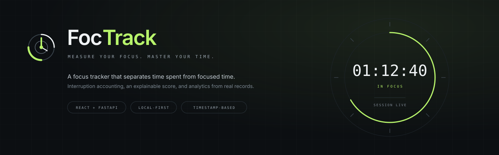
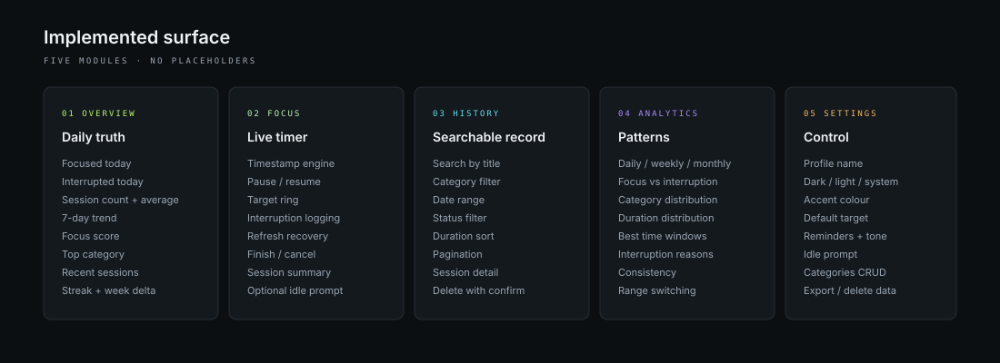
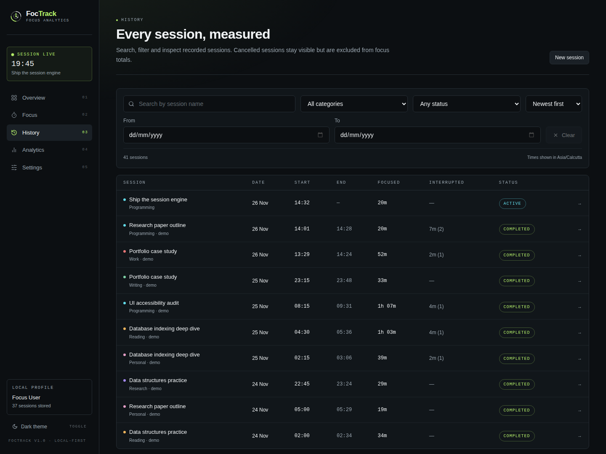
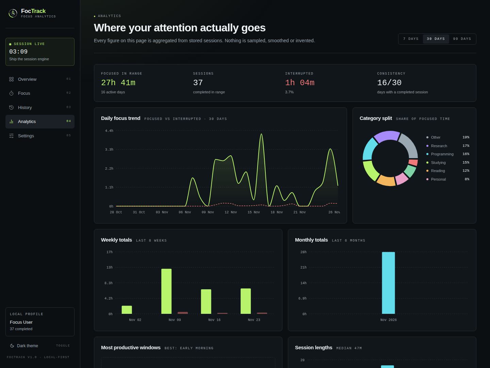

<p align="center">
  
</p>

<h1 align="center">FocTrack</h1>

<p align="center">
  <strong>Measure your focus. Master your time.</strong><br />
  A focus analytics application that separates <em>time spent</em> from <em>time focused</em>.
</p>

<p align="center">
  <a href="#quick-start">Quick start</a> ·
  <a href="#features">Features</a> ·
  <a href="#screenshots">Screenshots</a> ·
  <a href="#architecture">Architecture</a> ·
  <a href="#focus-score">Focus score</a> ·
  <a href="#api">API</a> ·
  <a href="#testing">Testing</a>
</p>

<p align="center">
  <a href="https://github.com/officialarghya29/FocTrack">github.com/officialarghya29/FocTrack</a><br />
  <a href="https://foctrack.vercel.app">foctrack.vercel.app</a> ·
  <a href="https://foctrack-api.onrender.com/docs">API documentation</a>
</p>

---

## The problem

Most focus timers record elapsed time rather than attention. A 50 minute session
containing twelve minutes of phone checks is still stored as 50 minutes, so the
metric overstates real focus and offers no basis for improvement.

FocTrack separates focused time, interrupted time and paused time into distinct
quantities. Each distraction is stored with a reason and a timestamp, producing
a dataset that answers specific questions: which categories consume the most
focused hours, when attention breaks, and whether sessions are completed.

Scope is intentionally narrow: private individual accounts, no social features,
no subscription layer, no team management. FocTrack is a measurement tool, not
a habit game.

## Philosophy

| Principle | What it means in the product |
|---|---|
| Measure, do not assume | Durations come from UTC timestamps, never from a ticking counter |
| Separate focus from presence | Pauses and interruptions are tracked as distinct intervals |
| Be honest about uncertainty | Empty states instead of fabricated statistics; insufficient-data instead of a fabricated score |
| Private by default | Every account is isolated by `user_id`; no other account can read, export or delete your data, and export and deletion are first-class actions |
| Explain every number | The focus score has visible weights and a documented formula |
| Visual restraint | One accent colour, minimal motion, no decorative dashboards |

---

## Features

<table>
<tr>
<td width="50%" valign="top">

**Focus timer**
- Timestamp-based clock — refresh, sleep or restart safe
- Start, pause, resume, finish, cancel
- Optional target duration with a progress ring
- One open session per user, enforced in the database
- Session recovery via `GET /sessions/active`
- Session summary after finishing

**Interruptions**
- Seven predefined reasons plus a custom label
- Notes per interruption
- Running and closed interruption display
- Deleting an interruption recalculates focus
- Optional inactivity prompt — never auto-logs

</td>
<td width="50%" valign="top">

**Dashboard**
- Today's focused and interrupted time
- Session count and average session
- Explainable focus score with component breakdown
- Seven-day trend, streak, week-over-week change
- Category breakdown and recent sessions

**History and analytics**
- Search, category, status and date filters
- Sort by duration, paginated
- Session detail with full timeline
- Daily, weekly and monthly charts
- Category, duration and time-of-day distributions
- Interruption reasons and frequency

</td>
</tr>
</table>

**Settings** include profile, dark/light/system theme, six accent colours, default
target, target reminders (with real browser permission), completion tone,
opt-in inactivity prompting, category management, JSON export, CSV import with
row-level error reporting, demo data mode and full history deletion.

<p align="center">
  
</p>

---

## Screenshots

Screenshots are captured from the running application. The dataset shown is the
built-in **demo mode** (40 sample sessions), which is labelled in the interface.

### Overview


### Focus timer


### Session history



### Analytics



### Settings


---

## Architecture

<p align="center">
  
</p>

The React client renders state and formats values; it never computes analytics.
FastAPI owns the session lifecycle, validates every transition and aggregates
the numbers. SQLAlchemy sits behind a database layer that runs unchanged on
SQLite locally and PostgreSQL in the hosted deployment.

Full detail: [`docs/architecture.md`](docs/architecture.md). Deployment
procedure: [`docs/deployment.md`](docs/deployment.md).

### Session lifecycle

<p align="center">
  
</p>

---

## Technology stack

| Layer | Technology | Notes |
|---|---|---|
| Frontend | React 18 + Vite 5 + TypeScript | Strict TS, route-level pages |
| Styling | Tailwind CSS 3 + CSS variables | Dark and light themes, user-selectable accent |
| Charts | Recharts 2 | Responsive, labelled, with empty states |
| Icons | Lucide React | Consistent 1.5px stroke set |
| Server state | TanStack Query 5 | Caching, invalidation, optimistic sync |
| Routing | React Router 7 | Five routes + 404 |
| Backend | Python 3.12 + FastAPI | OpenAPI at `/docs` |
| Validation | Pydantic 2 | camelCase on the wire, snake_case in Python |
| ORM | SQLAlchemy 2.0 | Typed mappings, explicit relationships |
| Migrations | Alembic | Applied to `head` at startup |
| Database | SQLite / PostgreSQL | SQLite locally; serverless PostgreSQL in deployment |
| Authentication | Bearer access tokens + rotated refresh tokens | Scrypt password hashes, optional Google sign-in |
| Backend tests | Pytest + HTTPX TestClient | 76 tests (SQLite and PostgreSQL) |
| Frontend tests | Vitest + Testing Library | 26 tests |
| Deployment | Vercel (frontend) + Render (API) + Neon (database) | Live on free tiers |
| Delivery | Route-level code splitting | Chart library isolated in its own chunk |

---

## Database schema

<p align="center">
  
</p>

| Table | Key columns | Purpose |
|---|---|---|
| `users` | `id`, `username`, `email`, `password_hash`, `google_sub`, `email_verified`, `token_version`, `created_at` | One row per account |
| `refresh_tokens` | `user_id`, `token_hash`, `expires_at`, `revoked_at` | Rotated sessions; only a SHA-256 digest is stored |
| `categories` | `id`, `user_id`, `name`, `color`, `is_default` | Unique per user (case-insensitive) |
| `focus_sessions` | `started_at`, `ended_at`, `status`, `target_duration`, `accumulated_active_seconds`, `paused_seconds`, `last_resumed_at`, `paused_at`, `focused_duration`, `interrupted_duration`, `is_demo` | Session record and clock anchors |
| `interruptions` | `session_id`, `reason`, `custom_reason`, `notes`, `started_at`, `ended_at`, `duration` | Distraction intervals |
| `user_settings` | `theme`, `accent_color`, `default_target_duration`, `notifications_enabled`, `sound_enabled`, `auto_idle_detection_enabled`, `idle_threshold_seconds` | Preferences |
| `alembic_version` | `version_num` | Migration state |

Constraints and indexes:

* `UNIQUE (user_id, name)` on categories.
* `UNIQUE INDEX uq_users_email_lower ON users (lower(email))` — one account per
  address regardless of the case used to type it.
* `UNIQUE INDEX uq_open_session_per_user ON focus_sessions (user_id) WHERE status IN ('ACTIVE','PAUSED')`
  — makes two simultaneous sessions impossible even under concurrency.
* Foreign keys with `CASCADE` for sessions → interruptions and users → data,
  and `SET NULL` for categories → sessions.
* Indexes on `user_id`, `started_at`, `ended_at`, `session_id`.

---

## Focus score

<p align="center">
  
</p>

```
focus ratio       = focused ÷ (focused + interrupted)
consistency ratio = completed ÷ (completed + cancelled)
focus score       = 100 × (0.80 × focus ratio + 0.20 × consistency ratio)
```

* Clamped to **0–100**, one decimal.
* **Paused time is excluded** from both numerator and denominator — a break does
  not lower the score.
* **Cancelled sessions** affect consistency only; their partial durations never
  count as focus.
* **Interruptions are capped** at active time when recorded, so they cannot be
  double counted.
* Below **3 completed sessions** or **5 minutes of activity** the API returns
  `insufficient_data` and the UI explains what unlocks it.
* The score is an application-defined indicator, **not** a clinically validated
  psychological measurement. The interface states this explicitly.

[`docs/calculations.md`](docs/calculations.md) has the full derivation and
worked example.

---

## Time calculation theory

```
wall time        = now − started_at
active time      = Σ running intervals
paused time      = Σ paused intervals
interrupted time = Σ interruption intervals (clipped to active time)
focused time     = max(0, active time − interrupted time)
```

* Timestamps are stored in **UTC**; day bucketing uses the browser's
  `tzOffsetMinutes` so "today" matches the user's calendar.
* A pause closes any open interruption at the pause boundary.
* Starting a new interruption closes the previous open one.
* Completing or cancelling freezes `focused_duration` and
  `interrupted_duration`; those frozen values feed analytics.
* No client counter is authoritative. The display extrapolates from the last
  server response and re-syncs on every fetch and window focus.

---

## API

Base path: `/api/v1`. Interactive documentation: `http://localhost:8000/docs`.
All responses are camelCase JSON; all timestamps are ISO-8601 UTC. Everything
except `/health`, `/health/ready` and `/auth/*` requires
`Authorization: Bearer <access token>`.

| Method | Endpoint | Description |
|---|---|---|
| `GET` | `/health` | Cheap liveness probe (no database access) |
| `GET` | `/health/ready` | Readiness probe; checks the database (`503` if down) |
| `POST` | `/auth/register` | Create an account (`201`) |
| `POST` | `/auth/login` · `/auth/google` | Start a session |
| `POST` | `/auth/refresh` | Rotate the refresh token |
| `POST` | `/auth/logout` · `/auth/logout-all` | End one session / every session |
| `GET` | `/auth/me` | Current account |
| `POST` | `/auth/change-password` | Change password and revoke old sessions |
| `DELETE` | `/auth/account` | Delete the account and all its data |
| `GET` | `/profile` · `PATCH /profile` | Read profile; edit display name only |
| `GET` | `/sessions/active` | Open session for recovery (or `null`) |
| `POST` | `/sessions` | Start a session (`201`) |
| `GET` | `/sessions` | Paginated list with `search`, `categoryId`, `status`, `dateFrom`, `dateTo`, `sort` |
| `GET` | `/sessions/{id}` | Single session with interruptions |
| `PATCH` | `/sessions/{id}` | Edit title, category, notes, target |
| `POST` | `/sessions/{id}/pause` · `/resume` | Clock transitions |
| `POST` | `/sessions/{id}/complete` · `/cancel` | Close a session |
| `DELETE` | `/sessions/{id}` | Delete session and interruptions (`204`) |
| `POST` | `/sessions/{id}/interruptions` | Log an interruption |
| `GET` | `/sessions/{id}/interruptions` | List interruptions |
| `POST` | `/interruptions/{id}/end` | Close an interruption |
| `DELETE` | `/interruptions/{id}` | Delete an interruption |
| `GET` | `/categories` · `POST` | List / create |
| `PATCH` | `/categories/{id}` · `DELETE` | Rename, recolour, delete |
| `GET` | `/settings` · `PATCH /settings` | Preferences |
| `GET` | `/analytics/overview` | Dashboard payload |
| `GET` | `/analytics/daily` | `?days=1..366` |
| `GET` | `/analytics/weekly` | `?weeks=1..52` |
| `GET` | `/analytics/monthly` | `?months=1..24` |
| `GET` | `/analytics/categories` | `?days=` |
| `GET` | `/analytics/focus-score` | Score plus components |
| `GET` | `/analytics/insights` | Distributions and reasons |
| `GET` | `/export` | Full JSON export download |
| `GET` | `/import/csv/template` | Download the CSV import template |
| `POST` | `/import/csv` | Import sessions from CSV (multipart file) |
| `DELETE` | `/data` | Delete all sessions |
| `POST` | `/demo/seed` · `DELETE /demo` | Add / remove labelled demo data |

Analytics endpoints accept `tzOffsetMinutes` (JavaScript
`Date.prototype.getTimezoneOffset()` convention).

### CSV import format

`POST /api/v1/import/csv` accepts a UTF-8 `.csv` file (maximum 2 MB, 5,000 data
rows). Download the template from `GET /api/v1/import/csv/template`.

| Column | Required | Notes |
|---|---|---|
| `title` | Yes | Up to 160 characters |
| `started_at` | Yes | ISO-8601; timestamps without an offset are treated as UTC |
| `ended_at` | No | Derived from durations when absent |
| `category` | No | Matched case-insensitively; unknown names are created |
| `focused_minutes` / `focused_seconds` | No | Defaults to the wall duration when both durations are absent |
| `interrupted_minutes` / `interrupted_seconds` | No | Cannot exceed the session length |
| `paused_minutes` / `paused_seconds` | No | Included in wall time only |
| `status` | No | `COMPLETED` (default) or `CANCELLED` |
| `notes` | No | Free text |

Each row produces one closed session; imports never create an open session.
Malformed rows are skipped and returned with their line numbers, while valid
rows are committed. Duplicate title/start pairs inside one file are rejected.

---

## Quick start

### Requirements

* Python 3.11+ (developed on 3.12.3)
* Node.js 18+ (developed on 22.16.0)
* npm

### 1. Backend

```bash
cd backend
python3 -m venv .venv
source .venv/bin/activate          # Windows: .venv\Scripts\activate
pip install -r requirements.txt
uvicorn app.main:app --reload --port 8000
```

On first start the API applies Alembic migrations and serves
`http://127.0.0.1:8000`. Swagger UI: `http://127.0.0.1:8000/docs`.

Open the web app, choose **Create an account**, and sign up. Registration creates
the account plus its own settings and eight default categories; there is no
shared profile and no seeded data.

### 2. Frontend

In a second terminal:

```bash
cd frontend
npm install
npm run dev
```

Open `http://localhost:5173`. The Vite dev server proxies `/api` to
`http://127.0.0.1:8000` by default. If your API runs elsewhere, set
`VITE_PROXY_TARGET` in `frontend/.env.local`.

### 3. Explore with sample data (optional)

After signing in, use **Settings → Demo data → Add**. Demo sessions are flagged
`isDemo` and labelled everywhere. Remove them the same way. No sample data is
created for a new account automatically.

### Environment configuration

Copy `.env.example` to `backend/.env` and/or `frontend/.env`, then adjust:

| Variable | Default | Purpose |
|---|---|---|
| `FOCTRACK_DATABASE_URL` | `sqlite:///backend/focustrack.db` | Database DSN; `postgres://` and `postgresql://` DSNs are accepted and use the psycopg 3 driver |
| `FOCTRACK_ENVIRONMENT` | `development` | Environment label |
| `FOCTRACK_CORS_ORIGINS` | local origins | Comma separated allowlist |
| `FOCTRACK_JWT_SECRET` | dev-only fallback | Access-token signing key; **production refuses to boot under 32 characters** |
| `FOCTRACK_GOOGLE_CLIENT_ID` | empty | Google OAuth Web client id; empty disables Google sign-in |
| `FOCTRACK_TRUST_FORWARDED_FOR` | `false` | Trust `X-Forwarded-For` from Render for rate limiting |
| `VITE_API_BASE_URL` | `/api/v1` | API base for the built frontend |
| `VITE_GOOGLE_CLIENT_ID` | empty | Shows the Google button only when set |
| `VITE_PROXY_TARGET` | `http://127.0.0.1:8000` | Dev proxy target |

No `.env` file is committed. Secrets never appear in the repository.

---

## Live deployment

| Component | Platform | URL |
|---|---|---|
| Web app | Vercel (static build) | https://foctrack.vercel.app |
| API | Render free web service | https://foctrack-api.onrender.com |
| API docs | FastAPI/Swagger on Render | https://foctrack-api.onrender.com/docs |
| Database | Neon free PostgreSQL | private connection string, not in the repository |

The deployment runs entirely on free tiers, which shapes the operational
behaviour:

* The Render service sleeps after 15 minutes without traffic. A scheduled
  GitHub Actions workflow pings `/health` every five minutes to keep it awake
  inside the 750 free instance-hours (schedule delivery can be delayed, so it
  is an optimisation, not a guarantee). The real guarantee is client-side:
  requests time out after 30 seconds, retry with backoff, and say the API is
  starting instead of spinning forever.
* The Neon database suspends its compute when idle and resumes on the next
  query. Connection pooling uses `pool_pre_ping` and a 300 second recycle, so a
  suspended database resumes instead of surfacing a stale-connection error.
  Startup migrations retry briefly rather than failing a deployment.
* `FOCTRACK_DATABASE_URL`, `FOCTRACK_CORS_ORIGINS` and
  `FOCTRACK_JWT_SECRET` are set in the Render dashboard. The deployed frontend
  origin is the only allowed CORS origin.
* Alembic migrations run on every boot, so the schema is versioned in
  production exactly as it is locally.
* Neon keeps an automatic point-in-time restore window on the free plan. For a
  local copy, download the JSON export from Settings or run
  `pg_dump "$FOCTRACK_DATABASE_URL" --no-owner --format=custom > focustrack.dump`.
  Free Neon storage is 0.5 GB and the free Render service has no persistent
  disk.

Step-by-step runbook, including CLI commands and verification:
[`docs/deployment.md`](docs/deployment.md).

---

## Testing

### Backend — 76 tests

```bash
cd backend
source .venv/bin/activate
pytest
```

Coverage includes registration, login, duplicate-email handling, refresh
rotation and replay detection, logout and logout-all, password changes, Google
linking rules, expired/forged/stale tokens, login and registration rate limits,
production secret enforcement, and full tenant isolation (sessions,
interruptions, categories, analytics, export, import and deletion). The
pre-existing session, analytics, focus-score, category, settings, CSV and
health assertions all run behind real bearer tokens. The suite uses an isolated
SQLite file per test and a controllable clock, so no test sleeps or depends on
wall time. Set `FOCTRACK_TEST_DATABASE_URL` to a PostgreSQL DSN to run the same
assertions against the hosted dialect.

Result on this machine: **76 passed** on SQLite. The same suite also runs
against PostgreSQL 16 in CI.

### Frontend — 26 tests

```bash
cd frontend
npm test
```

Coverage includes time formatting and rounding, day boundaries, timer rendering
and screen-reader status, required-title validation, session creation with the
selected category and target, dialog focus retention while a live timer
re-renders the page, removal of a finished session from the active cache, the
retry policy that tolerates a cold-starting API (gateway errors, timeouts and
5xx responses, but never a 401), session restoration, login, logout clearing
the query cache, guarded-route redirects, and hiding the Google button when no
client id is configured.

Result on this machine: **26 passed across 7 files**.

### Production build

```bash
cd frontend
npm run build
```

Result on this machine:

```
dist/index.html                  0.89 kB │ gzip:   0.48 kB
dist/assets/index-*.css         31.20 kB │ gzip:   6.99 kB
dist/assets/index-*.js          30.40 kB │ gzip:   9.51 kB
dist/assets/react-*.js         179.62 kB │ gzip:  59.05 kB
dist/assets/query-*.js          42.09 kB │ gzip:  12.69 kB
dist/assets/charts-*.js        424.70 kB │ gzip: 114.11 kB
dist/assets/Dashboard-*.js      17.86 kB │ gzip:   5.50 kB
dist/assets/Focus-*.js          27.17 kB │ gzip:   7.99 kB
dist/assets/History-*.js        12.85 kB │ gzip:   4.07 kB
dist/assets/Analytics-*.js      12.50 kB │ gzip:   3.85 kB
dist/assets/Settings-*.js       19.52 kB │ gzip:   6.02 kB
✓ built in 2.98s
```

Pages are loaded per route. Shell, React and TanStack Query total about 88 kB
gzipped; the 114 kB gzip chart chunk is fetched only by the Overview and
Analytics routes.

---

## Results and performance

### API timings

Measured locally against the running API with **41 stored sessions**, using
40 sequential requests per endpoint on loopback (`curl`, single machine,
Python 3.12, SQLite). These are observations from one environment and do not
constitute a general benchmark.

| Endpoint | Mean response |
|---|---|
| `GET /analytics/overview` | 39.1 ms |
| `GET /sessions?limit=20` | 12.9 ms |
| `GET /analytics/daily?days=30` | 10.8 ms |
| `GET /categories` | 4.2 ms |

`/analytics/overview` is the heaviest call because it composes several
aggregations (today, week, previous week, score, categories, recent sessions).

### Reproduce the measurement

```bash
for i in $(seq 1 40); do
  curl -s -o /dev/null -w "%{time_total}\n" \
    "http://127.0.0.1:8000/api/v1/analytics/overview?tzOffsetMinutes=0"
done | awk '{s+=$1} END {printf "mean: %.1f ms\n", s/NR*1000}'
```

No database, browser-render or deployment benchmarks are claimed.

### What is verified

| Check | Status |
|---|---|
| Alembic upgrade from empty database | Passed (`0001_initial` → `0002_auth`) |
| API boots and serves health + Swagger | Passed |
| Session lifecycle over HTTP | Passed (backend tests + manual smoke test) |
| Analytics from stored rows | Passed |
| Frontend production build | Passed |
| Frontend/backend integration | Passed (local pair, then the deployed pair) |
| PostgreSQL test run | Configured in CI (PostgreSQL 16 service); not yet observed green |
| Account isolation (two accounts, every endpoint) | Passed (dedicated backend tests) |
| Auth rate limiting and token revocation | Passed (dedicated backend tests) |
| CSV import (valid and malformed rows) | Passed (9 dedicated tests) |
| Dependency audit (pip-audit, npm audit) | Passed (0 known vulnerabilities) |
| Dark and light themes | Rendered and visually checked |
| Mobile layout (390 × 844) | Rendered and visually checked |
| Deployed to Vercel/Render/Neon | Passed — [foctrack.vercel.app](https://foctrack.vercel.app), health and smoke checks run against the live pair |

`npm audit --omit=dev` reports zero known vulnerabilities after the React
Router 7 upgrade.

---

## FocTrack and ordinary Pomodoro timers

| Capability | Basic Pomodoro timer | FocTrack |
|---|---|---|
| Focus session timer | Yes | Yes |
| Session history | Varies | Yes |
| Manual interruption logging | Often limited | Yes |
| Interruption reasons | Often limited | Yes |
| Focus analytics | Varies | Yes |
| Category-wise tracking | Varies | Yes |
| Explainable focus score | Usually absent | Yes |
| Productivity trends | Varies | Yes |
| Data ownership | Depends on product | Local-first |

FocTrack is not positioned as universally superior. A simple countdown timer
remains the more appropriate tool when only time-boxing is required.

---

## Limitations

The current release has the following constraints.

1. **No password reset or email verification yet.** Accounts are isolated and
   rate-limited, but this deployment has no transactional email provider, so
   the reset page says so instead of pretending. Email addresses created with a
   password are marked unverified, which also blocks linking them to a Google
   identity until verification exists.
2. **Auth rate limiting is per process.** The API runs as one Render instance;
   if it is ever scaled out, the limiter must move to a shared store.
3. **Free-tier hosting.** The API sleeps after 15 minutes of inactivity, so the
   first request afterwards can take up to a minute to wake it. A keep-warm
   workflow mitigates this, and the client retries with a visible starting-up
   message. The database is a free Neon instance (0.5 GB) that suspends when
   idle. Fine for personal use; not an always-on service.
4. **Analytics aggregate in Python.** Correct and portable, but not the fastest
   approach for very large histories. Measured timings above reflect ~40 rows.
5. **Reminders need an open tab.** Browser notifications fire only while the app
   is running in a tab; there is no service worker or push backend.
6. **No automatic inactivity logging.** This is intentional: the interface
   prompts before anything is recorded.
7. **Focus score is a heuristic.** It is transparent, but it is not a validated
   psychological instrument.
8. **Charts dominate the chart payload.** Recharts is isolated in a 114 kB gzip
   chunk that only the Overview and Analytics routes fetch. Replacing it with a
   lighter renderer remains a candidate optimization.
9. **No offline mode.** The UI requires the API; there is no service worker.
10. **Import is session-level.** CSV rows create sessions with aggregate
    durations; individual interruptions are not reconstructed from CSV.
11. **Historical days use the current UTC offset.** Analytics applies the
    browser's present offset to past sessions, so a history spanning a daylight
    saving change can shift an old day by one hour. Storing the offset per
    session is the planned fix.

---

## Roadmap

The following items are not implemented in 1.1 and are ordered by expected
value.

- Password reset and email verification through a transactional email provider
- Automation coverage (Playwright) for the full sign-up → record → sign-out journey
- Trim the chart chunk by replacing Recharts or lazy-mounting below-fold charts
- Weekly review view with goal setting and comparison
- Offline-first PWA shell with a sync queue
- Keyboard-first command palette and timer shortcuts

---

## Contributing

FocTrack is proprietary software. Issues and suggestions are welcome. Code
contributions require prior agreement with the author, and by submitting a pull
request you confirm that you hold the rights to the contribution and assign them
to the project owner.

1. Fork the repository and create a branch: `feat/short-description`.
2. Keep the layering intact: routes → services → models. No SQL in routers, no
   analytics in components.
3. Any change to time maths must include a test that would fail without it.
4. Run before opening a pull request:

```bash
cd backend && pytest
cd frontend && npm test && npm run build
```

5. Describe the behaviour change and the checks you ran. Pull requests must not
   weaken assertions or skip tests to make a build pass.

Bug reports should include reproduction steps, expected vs actual behaviour, and
whether demo data was loaded.

---

## License

Copyright © 2026 Arghya Bose. **All rights reserved.**

This repository is proprietary. No licence is granted to copy, modify,
distribute or use the work without prior written permission. See
[LICENSE](LICENSE) for the full terms and the permission contact.

<p align="center">
  <sub>FocTrack 1.1 · Private focus analytics</sub>
</p>
